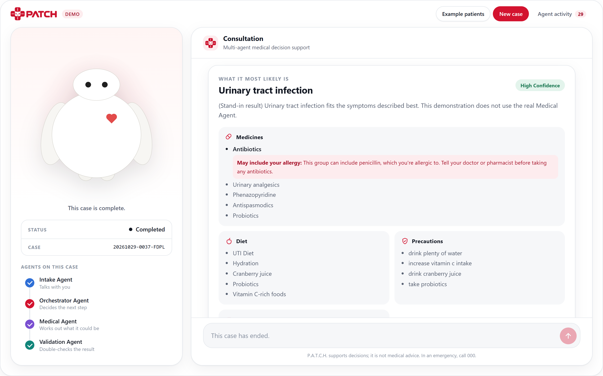
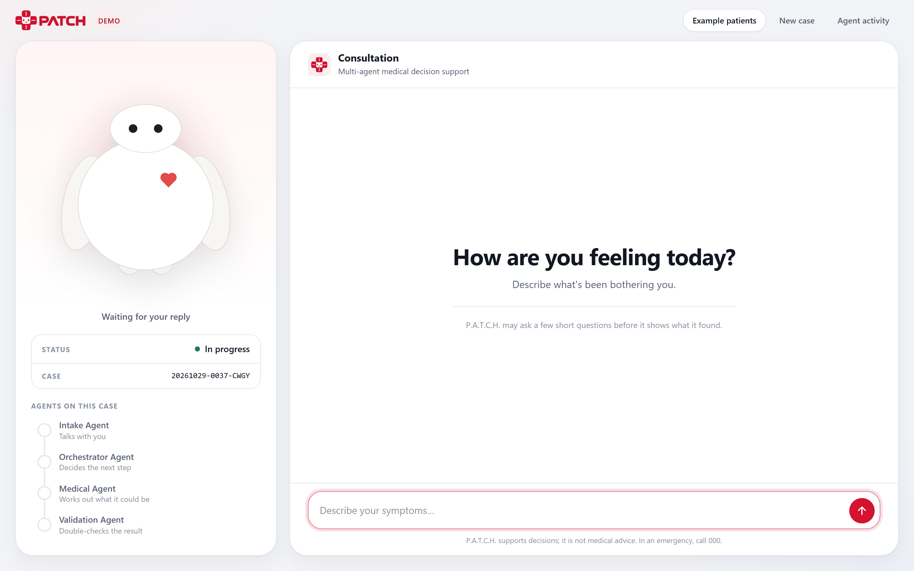
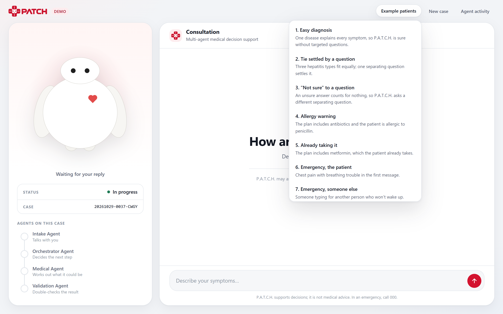
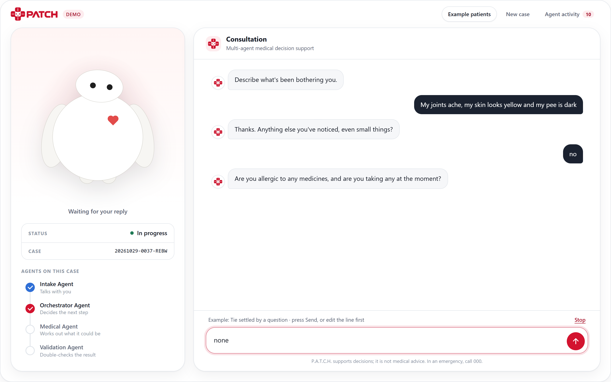
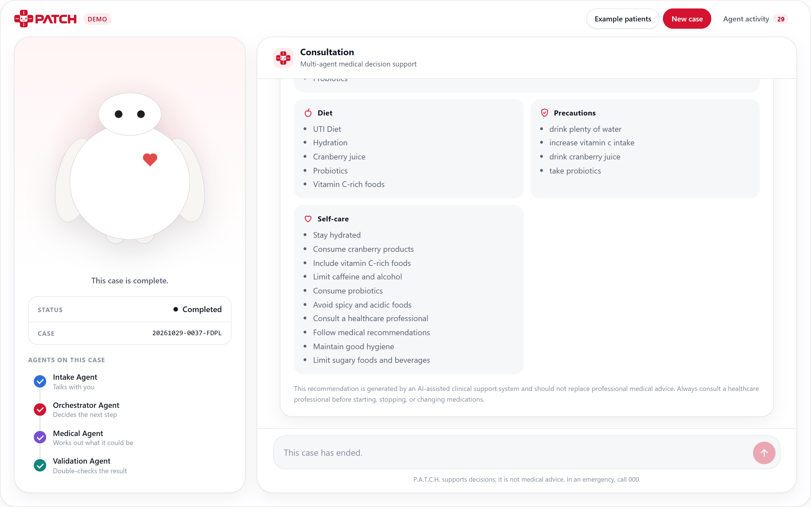
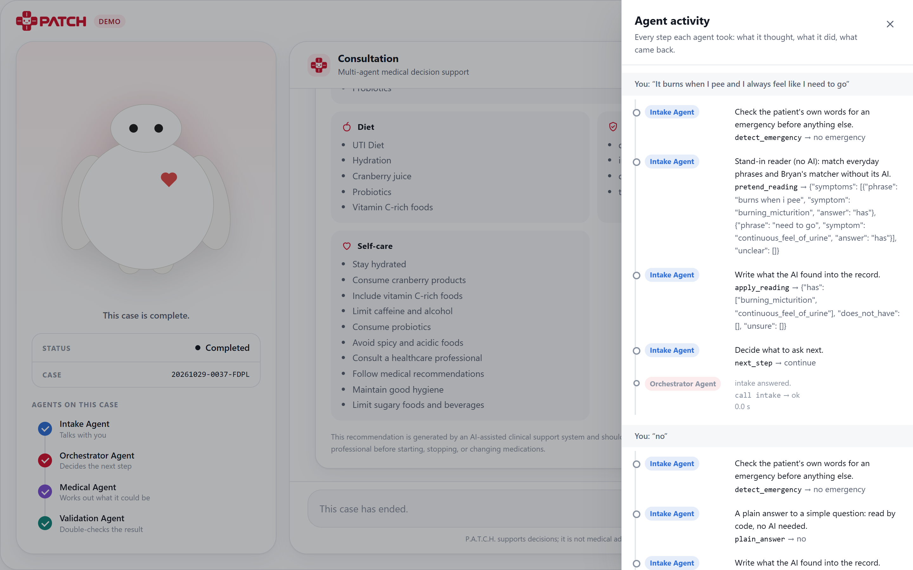
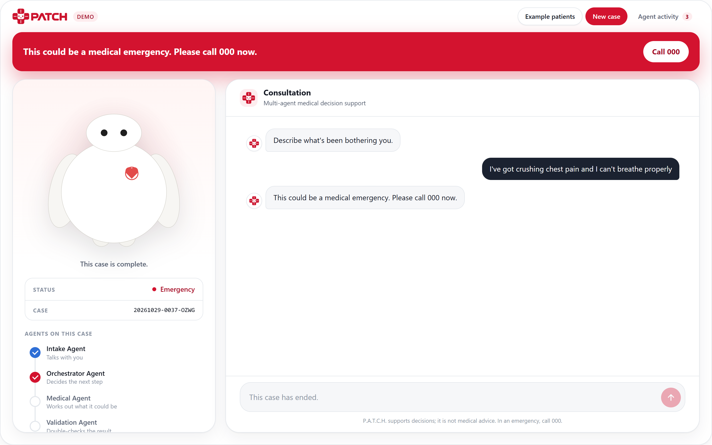
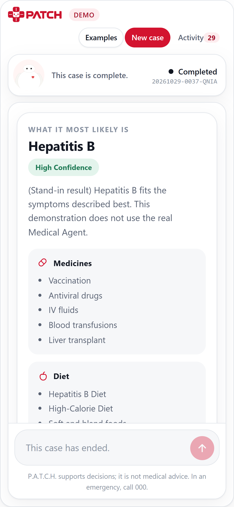
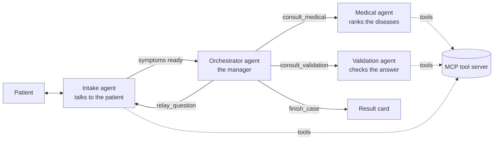

  

<h3 align="center">A multi-agent AI system for medical decision support</h3>

  COS30018 Intelligent Systems · Swinburne University of Technology · Group project (Option A), 2026

  
  
  
  
  

> [!NOTE]
> The source code is in a private university repository, so this repo is a showcase only.
> P.A.T.C.H. is a learning project. It is **not** medical advice and is not meant for clinical use.

## Overview

P.A.T.C.H. is a chat where a patient describes how they feel in their own words. Four AI agents
work together to find the most likely of 41 diseases, check the answer, and show the treatment
guidance from the dataset. If the right answer is to call 000 or see a doctor, it says that instead.

**Example consultation**

> **Patient:** "It burns when I pee and I always feel like I need to go." 
> **P.A.T.C.H.:** "Anything else you've noticed?" → *no* 
> **P.A.T.C.H.:** "Are you allergic to any medicines, and are you taking any?" → *I'm allergic to penicillin* 
> **Result:** Urinary tract infection (high confidence), the treatment plan, and a warning beside
> antibiotics: *"This group can include penicillin, which you're allergic to."*

## Highlights

- **Four cooperating agents:** Intake, Medical, Validation and an Orchestrator (the manager) that
  decides who works next.
- **Safety first:** every message is checked for emergencies and self-harm before anything else,
  and an emergency ends the case with a call-000 alert.
- **Asks follow-up questions:** when it isn't sure, the Medical agent picks the one question that
  best tells the top diseases apart (at most four).
- **Checks medicine safety:** compares the plan against the patient's allergies and current
  medicines using the RxNav API.
- **Blind second opinion:** when the result is uncertain, a different model reviews the case
  without seeing the first answer.
- **Transparent:** an "Agent activity" drawer shows every step each agent took, which tool it
  called, and what came back.
- **Thoroughly tested:** 796 automated tests run free, without AI calls, plus an evaluation
  pipeline with simulated patients.

## Walkthrough

<table>
  <tr>
    <td width="50%" valign="top">
      <b>1. Welcome screen</b> 
      The companion panel on the left tracks the case; the chat is on the right.  
      
    </td>
    <td width="50%" valign="top">
      <b>2. Example patients</b> 
      15 built-in test patients demonstrate each scenario, from easy diagnoses to emergencies.  
      
    </td>
  </tr>
  <tr>
    <td width="50%" valign="top">
      <b>3. During a consultation</b> 
      The Intake agent asks follow-up questions, and the tracker shows which agents have worked on the case.  
      
    </td>
    <td width="50%" valign="top">
      <b>4. Result with an allergy warning</b> 
      The plan includes antibiotics, so the patient's penicillin allergy is flagged beside them.  
      
    </td>
  </tr>
  <tr>
    <td width="50%" valign="top">
      <b>5. Full result card</b> 
      Medicines, diet, precautions and self-care, copied from the dataset rather than written by the AI.  
      
    </td>
    <td width="50%" valign="top">
      <b>6. Agent activity drawer</b> 
      Every agent step, tool call and result, so each decision can be traced.  
      
    </td>
  </tr>
  <tr>
    <td width="50%" valign="top">
      <b>7. Emergency detection</b> 
      Red-flag symptoms stop the case immediately and show a call-000 alert.  
      
    </td>
    <td width="50%" valign="top" align="center">
      <b>8. Mobile layout</b> 
      The interface adapts to small screens.  
      
    </td>
  </tr>
</table>

These screenshots come from the free demo mode, which uses stand-in agents. That is why the
result text says "Stand-in result".

## Results

Evaluated on 60 unseen simulated patients with the real agents:

| Metric | Result |
|---|---|
| First guess correct | **97%** |
| Correct disease in the top 3 | **100%** |
| Approved but wrong | 2% |
| Questions per patient (average) | 3.6 |
| Cost per patient | about 1–2 cents |

Simpler baselines (a plain classifier, or a single LLM call) named the wrong disease for
**48–73%** of the same patients.

## Architecture

| Agent | Role |
|---|---|
| **Intake** | The only agent that talks to the patient. It screens for emergencies, records each symptom as has, doesn't have or not sure, and asks about allergies and medicines. |
| **Medical** | Ranks the 41 diseases from the symptoms and chooses discriminating questions. The treatment plan is copied from the data and never written by the AI. |
| **Validation** | The reviewer. It checks emergency patterns, whether the patient was understood correctly, medicine safety, and gets a second opinion when needed. |
| **Orchestrator** | The manager. It plans the next step with four tools. Code inside each tool enforces the rules, and fixed rules take over if the AI manager fails. |

The agents use 12 tools served over **MCP**, including `detect_emergency`, `rank_diseases`,
`find_discriminating_symptom`, `check_medicine_safety` and `get_second_opinion`.

## Tech stack

- **Language:** Python
- **Agents:** [smolagents](https://github.com/huggingface/smolagents) `ToolCallingAgent`
- **Tools:** Model Context Protocol (MCP) server
- **Models (via OpenRouter):** GPT-4o-mini (Intake), GPT-4.1-mini (Medical, Validation, Orchestrator), Claude Haiku 4.5 (second opinion)
- **Web:** Starlette backend with plain HTML, CSS and JavaScript (no framework)
- **External API:** RxNav, for medicine and allergy checks
- **Testing:** pytest, plus a custom evaluation runner with simulated patients
- **Data:** [Medicine Recommendation System Dataset](https://www.kaggle.com/datasets/noorsaeed/medicine-recommendation-system-dataset) (Kaggle): 4,920 records covering 41 diseases

## My contribution

- Designed **Architecture v2**, the multi-agent design the final system is built on.
- Wrote the **agent specifications** that define each agent's job, tools and rules.
- Built the first **Medical agent**, the `classify_disease` tool and the Medical tools.
- Built the **Medical agent evaluation**.

## Team

Group 7: Maisha, Khor Bryan Jun Hean, Arrisha and Anas.

---

Developed for COS30018 Intelligent Systems at Swinburne University of Technology. The source code is
private because of academic integrity rules; it is available on request.
